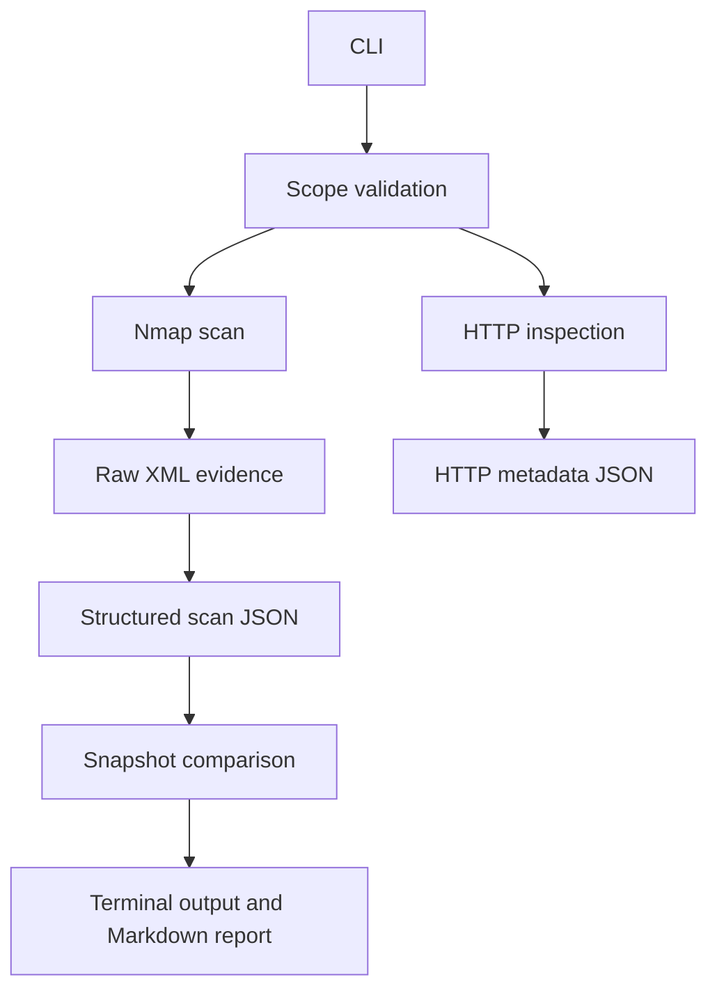

# LabScope

A Python CLI for scoped reconnaissance, HTTP metadata collection,
and service-state change detection in explicitly authorized environments.

LabScope validates requested destinations, runs controlled Nmap scans,
preserves evidence, and compares saved snapshots. It can also collect
HTTP response metadata and generate Markdown comparison reports.

## Features

- Explicit IPv4 target and port allowlists.
- Dry-run scan planning without network traffic.
- TCP connect scanning through Nmap.
- Saved command arguments, raw XML, and structured JSON.
- Port-state comparison with scan-coverage checks.
- HTTP status, headers, and HTML title collection.
- HTTP destination validation without automatic redirect following.
- Markdown comparison reports.
- Protection against overwriting existing evidence.
- 37 automated tests covering validation, parsing, comparison,
  reporting, execution failures, and HTTP behavior.

## Workflow



HTTP evidence is saved separately from scan snapshots.
The current comparison engine compares scan port states.

## Requirements

- Python 3.11 or newer.
- Nmap available on PATH for scanning.
- Git for development.

The application uses Python's standard library and requires no
third-party Python runtime packages.

Development and live validation were performed on Kali Linux using
a Docker-hosted OWASP Juice Shop instance.

## Installation

From the repository root:

```bash
python3 -m venv .venv
source .venv/bin/activate
python -m pip install -e .
labscope --help
```

On Kali, install missing prerequisites with:

```bash
sudo apt install python3-venv git nmap
```

## Scope configuration

Example: `examples/scope.json`

```json
{
  "allowed_targets": ["127.0.0.1"],
  "ports": [8002]
}
```

Only authorize addresses and ports you are permitted to test.
The configured ports apply to each allowed target.

## Usage

Preview an approved scan plan:

```bash
labscope scan --scope examples/scope.json --dry-run
```

Run a scan into a new directory:

```bash
labscope scan --scope examples/scope.json \
  --output runs/baseline
```

Each successful scan saves:

- `command.json`: Nmap arguments.
- `nmap.xml`: raw scan evidence.
- `results.json`: parsed scan results.
- `stderr.txt`: Nmap warnings or errors.

Collect HTTP metadata:

```bash
labscope web --scope examples/scope.json \
  --url http://127.0.0.1:8002/ \
  --output runs/web.json
```

This requires an authorized HTTP service listening at that address.
Each output file or scan directory must be new.

## Reproduce the included demonstration

The example snapshots record a controlled localhost test:
TCP port 8002 was open while Juice Shop was running and closed
after its container was stopped.

Compare the saved evidence without sending network traffic:

```bash
labscope compare \
  examples/demo/before.json \
  examples/demo/after.json
```

Expected output:

```text
Port-state changes: 1
127.0.0.1 tcp/8002: open -> closed
```

Generate another report:

```bash
labscope compare \
  examples/demo/before.json \
  examples/demo/after.json \
  --report reports/demo.md
```

Check unchanged behavior:

```bash
labscope compare \
  examples/demo/before.json \
  examples/demo/before.json
```

Expected output:

```text
No port-state changes detected.
```

See [the included comparison report](examples/demo/comparison.md).

## Tests

```bash
python -m unittest discover -s tests -v
```

The current suite contains 37 tests. External Nmap execution and
HTTP connections are mocked in the automated tests.

Separate manual validation demonstrated:
- A localhost service changing from open to closed.
- An unchanged snapshot comparison.
- HTTP 200 and title collection from Juice Shop.
- Rejection of an unauthorized HTTP port.

## Limitations

- Targets must be explicit IPv4 addresses; hostnames, CIDRs,
  and IPv6 are not supported.
- Nmap scanning currently checks TCP port states without active
  service-version detection.
- Port-database service labels are guesses, not verified applications.
- Comparison requires matching hosts, declared scan coverage,
  and explicit port records.
- Grouped port-state summaries are preserved during parsing but
  rejected by the comparator.
- Service metadata and HTTP metadata changes are not yet compared.
- HTTP redirects are recorded without being followed.
- HTTP inspection samples up to 64 KiB of the response body.
- Titles are extracted from returned HTML without executing JavaScript.
- The HTTP timeout applies to socket operations, not total elapsed time.
- HTTPS uses certificate verification; self-signed lab certificates
  may fail validation.
- Collected headers may contain sensitive values; review evidence
  before sharing it.
- Observations do not automatically establish vulnerabilities.
- Time savings and broader detection accuracy have not been measured.

## Intended use

Use only on systems you own or have explicit authorization to assess.
Keep deliberately vulnerable applications confined to your lab.
